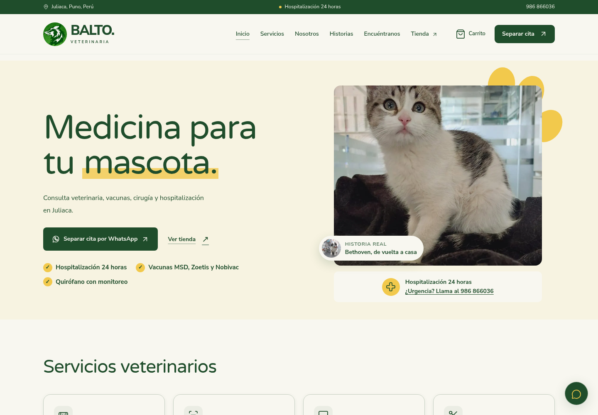

# BALTO Veterinaria

**¿Vas a instalar BALTO en tu laptop?** [Sigue la guía paso a paso](docs/replicar-balto.md).

Hicimos una tienda de prueba para BALTO Veterinaria, en Juliaca. Puedes abrir el catálogo, preguntarle al chat por un producto y hacer un pedido para recogerlo en el local.

[Ver la demo en AWS](https://balto-veterinaria.3-211-103-160.sslip.io/) · [Guía de despliegue](docs/aws-deploy.md)



## Qué puedes probar

- **Tienda.** Busca un producto, abre su ficha y agrégalo al carrito. El catálogo y las existencias son de ejemplo.
- **Pedidos.** Solicita el retiro en tienda con pago al recoger o Yape coordinado por WhatsApp. La tarjeta usa Mercado Pago Checkout Pro en modo de prueba cuando está configurado.
- **Chat.** Pregunta «¿Dónde venden Dog Chow?» o «¿Qué horarios tienen?». n8n consulta Drupal y responde con los datos del negocio. Gemini puede ayudar a interpretar las preguntas que las reglas no reconocen.
- **Administración.** Revisa los pedidos, edita el catálogo y consulta el stock. Si configuras Telegram, el dueño puede recibir avisos y confirmar un abono por Yape después de comprobarlo.

[Catálogo](docs/capturas/fase-3-portada-tienda.png) · [Chat en móvil](docs/capturas/fase-6-chat-movil.png) · [Panel de pedidos](docs/capturas/fase-4-pedidos-admin.png)

## Preparar y levantar la demo

Necesitas **Git, Python 3 y Docker con Compose v2**. En Windows puedes usar Docker Desktop con WSL2.

```bash
git clone https://github.com/dimas-flores/balto-veterinaria-proyecto.git
cd balto-veterinaria-proyecto
python3 scripts/init-env.py
docker compose up -d
docker compose ps -a
```

La primera instalación puede tardar varios minutos. Puedes seguirla con `docker compose logs -f drupal-init`. Cuando el instalador termine con código 0 y los servicios aparezcan saludables, ejecuta `bash scripts/verify.sh`.

| Acceso local | Cómo entrar |
| --- | --- |
| [Tienda](http://localhost:8080) | Abre el catálogo o el chat en el navegador. |
| [Administración de Drupal](http://localhost:8080/user/login) | El usuario inicial es `admin_balto` y su contraseña está en `DRUPAL_ADMIN_PASSWORD` en tu `.env`. |
| [Editor de n8n](http://localhost:5678) | Crea la cuenta propietaria al entrar por primera vez. Compose importa y publica el chatbot al arrancar. |

Para que otros equipos de la red la abran por IP, ejecuta `python3 scripts/configure-local-ip.py` y luego `docker compose up -d --force-recreate drupal n8n` ([detalles](docs/docker-local.md#abrir-la-demo-por-ip-red-del-aula)).

Puedes detener la demo con `docker compose stop` y volver a levantarla con `docker compose up -d`. Los volúmenes conservan los datos y las cuentas. Si cambias código PHP, reconstruye la imagen con `docker compose up -d --build`.

[Guía completa de instalación y solución de problemas](docs/replicar-balto.md)

## Arquitectura

En AWS, **Caddy** recibe el tráfico HTTPS y dirige la tienda a **Drupal Commerce** y el webhook del chat a **n8n**. **MariaDB** guarda el catálogo y los pedidos. **n8n** guarda sus flujos y credenciales en su propio volumen, consulta la API interna de Drupal y envía avisos a Telegram. El editor de n8n se abre por un túnel SSH. La IP elástica de EC2 permite conservar el enlace de la demo después de apagar y encender la instancia.

| Componente | Función |
| --- | --- |
| Drupal Commerce + tema Twig | Portada, catálogo, carrito, checkout y gestión de pedidos. |
| MariaDB | Datos de la tienda y configuración de Drupal. |
| n8n | Chatbot y automatizaciones de pedidos, stock y Telegram. |
| Caddy | Entrada pública HTTPS en EC2. |

[Diagrama de los flujos de n8n](docs/diagramas/flujo-n8n.png) · [API interna](docs/fase-5.md) · [Guía de AWS](docs/aws-deploy.md)

## Gemini opcional en el chat

El chat funciona con reglas locales. Si habilitas Gemini, n8n le envía el mensaje actual solo cuando las reglas no reconocen la intención. Drupal proporciona los datos y n8n arma la respuesta.

```bash
python3 scripts/configure-gemini.py --env .env
docker compose up -d --force-recreate n8n
```

El configurador pide la clave de Google AI Studio sin mostrarla en pantalla. El archivo `.env` y las credenciales son privados. Para configurar las demás integraciones, sigue la [guía de réplica](docs/replicar-balto.md#6-activar-y-verificar-integraciones-de-prueba).

## Guías y pruebas

| Si quieres… | Consulta |
| --- | --- |
| Instalar BALTO y preparar una demostración | [Guía de réplica](docs/replicar-balto.md) |
| Recorrer la administración de la tienda | [Guía rápida de Drupal](docs/guias/guia-rapida-drupal.md) |
| Probar checkout, pagos de prueba o roles | [Compra y pedidos](docs/fase-4.md) · [Pagos automáticos](docs/pagos-automaticos.md) |
| Entender o modificar el chatbot | [Guía del chat](docs/fase-6.md) |
| Verificar la demo completa | [Pruebas integradas](docs/fase-7.md) · [Evidencia de EC2](docs/verificacion-fase-9-ec2.json) |
