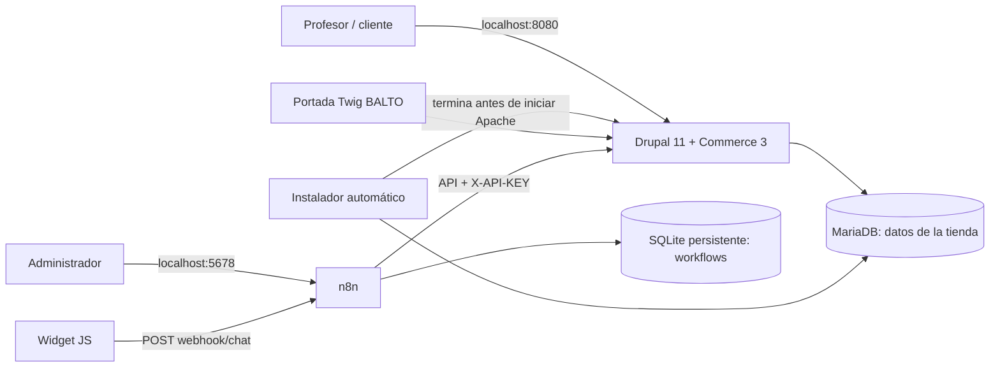
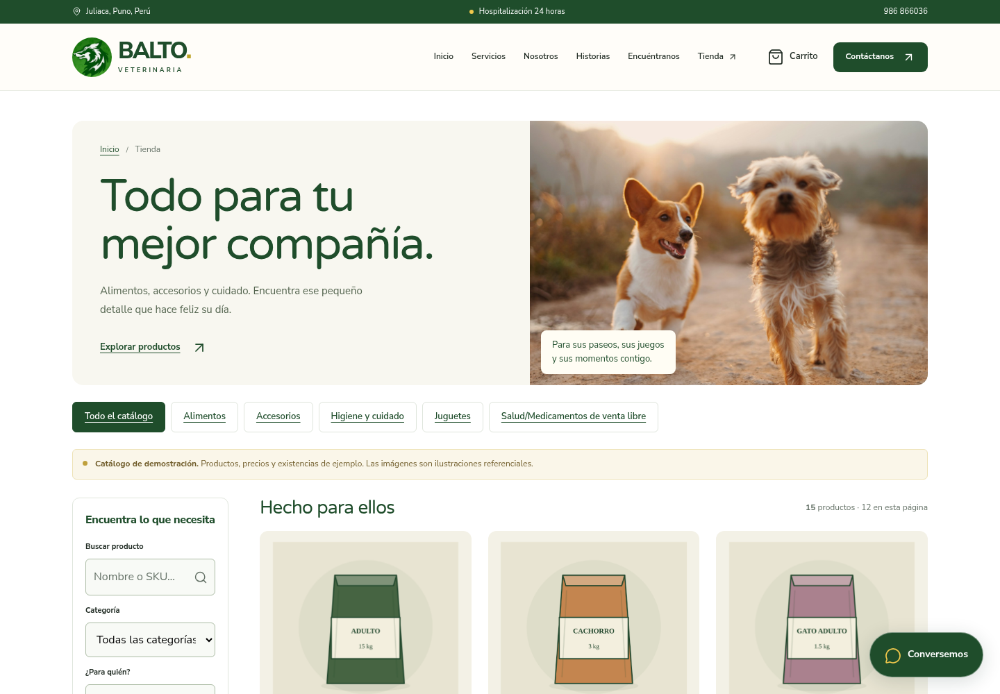
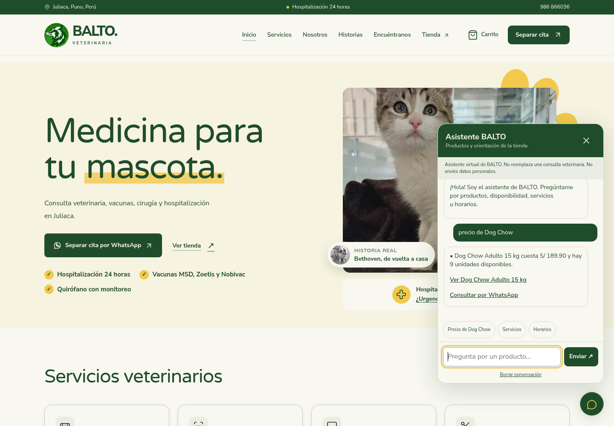

# BALTO Veterinaria

Proyecto académico de tienda virtual con Drupal Commerce, MariaDB y chatbot mediante n8n. Marca: **BALTO Veterinaria — Medicina para tu mascota**, Juliaca, Puno, Perú. Moneda: soles (PEN).

Este proyecto académico documenta el análisis, diseño e implementación de una tienda virtual para BALTO Veterinaria. Integra catálogo y pedidos con Drupal Commerce, almacenamiento en MariaDB y un chatbot conectado mediante n8n. La tienda permite explorar productos, filtrar por mascota y continuar al carrito; las funciones implementadas y su verificación se describen en las guías de cada fase.

Para ejecutar la demostración en una computadora local, consulta la [guía de instalación y ejecución](#preparar-y-levantar-la-demo).

## Diseño de tienda y pagos automáticos preparados

La portada incluye búsqueda, navegación por mascota y productos cargados desde Commerce. Referencias y recursos en [diseño](docs/recursos-diseno.md).

La integración opcional de Culqi para billeteras por QR y banca móvil/PagoEfectivo está desarrollada y verificada con HTTP simulado; **la pasarela permanece desactivada, sin credenciales y sin cobros reales**. Faltan cuenta de comercio, prueba con el proveedor, webhook HTTPS público y programación de conciliación. Estado y alcance en [pagos automáticos](docs/pagos-automaticos.md).

## Arquitectura



MariaDB no publica puertos. Los servicios se comunican en una red Docker compartida. n8n usa su SQLite incorporado para evitar otro servicio de base de datos; los datos del negocio permanecen en MariaDB. El chat llama a n8n, que consulta la API interna de Drupal con una credencial de cabecera.

## Requisitos

- Docker Engine activo y Docker Compose v2 o superior. En Windows, Docker Desktop con WSL2.
- Git y Python 3 para preparar el repositorio y generar secretos.
- Conexión a internet para la primera construcción.
- Como objetivo de la demo, reservar al menos 4 GB de RAM para los servicios y espacio para imágenes y volúmenes.

No hace falta instalar PHP, Composer, Drupal ni MariaDB en la computadora del profesor.

## Preparar y levantar la demo

1. Abre una terminal en la carpeta del repositorio.
2. Comprueba el motor y Compose:

   ```bash
   docker info
   docker compose version
   ```

3. Genera `.env` una sola vez:

   ```bash
   python3 scripts/init-env.py
   ```

4. Levanta los servicios:

   ```bash
   docker compose up -d
   ```

5. Consulta el progreso de la primera instalación:

   ```bash
   docker compose logs -f drupal-init
   ```

6. Comprueba los servicios y ejecuta la verificación:

   ```bash
   docker compose ps -a
   bash scripts/verify.sh
   ```

7. Abre Drupal en <http://localhost:8080> y n8n en <http://localhost:5678>.

**Resultado esperado y comprobado:** MariaDB, Drupal y n8n saludables; `drupal-init` finalizado con código 0; siete servicios, cinco categorías y una tienda en PEN cargados, con el tema BALTO activo. La primera ejecución construye la imagen e importa las traducciones; puede tardar varios minutos.

Tras esta preparación, el comando de arranque diario es únicamente `docker compose up -d`. Para cambios del código PHP o dependencias, usa `docker compose up -d --build`.

## Acceder como administrador

1. Abre <http://localhost:8080/user/login>.
2. Usa el usuario `admin_balto` (o el valor de `DRUPAL_ADMIN_USER` en `.env`).
3. Consulta `DRUPAL_ADMIN_PASSWORD` en tu archivo `.env` local e introduce su valor.
4. Abre <http://localhost:8080/admin/commerce> para Commerce o <http://localhost:8080/admin/config/balto/negocio> para editar contacto y horarios.

**Resultado esperado:** acceso al panel de Commerce. El generador crea una contraseña distinta por instalación. No existe una contraseña pública compartida ni se guarda una contraseña real en este README.

En n8n, crea la cuenta propietaria desde la pantalla inicial. Se conserva en su volumen; la creación de esta cuenta no es necesaria para que Drupal arranque. El workflow se importa y publica automáticamente al arrancar. La cuenta propietaria permite revisarlo y editarlo, pero no es necesaria para que el chat responda. Consulta la [guía del chatbot](docs/fase-6.md).

## Datos reales y datos pendientes

| Dato | Valor |
| --- | --- |
| Nombre | BALTO Veterinaria |
| Lema | Medicina para tu mascota |
| Sede central | Jr. Ignacio Miranda N° 220, Juliaca |
| Segunda sede | Jr. Ignacio Miranda con Jr. Lima, Centro Comercial N° 3, Tienda N° 3 |
| WhatsApp | [986 866036](https://wa.me/51986866036) |
| Facebook | BALTO Veterinaria; enlace exacto pendiente |
| Correo del negocio | Pendiente; no se publica uno inventado |
| Hospitalización | 24 horas |
| Consultorio / tienda | **Ejemplo:** lunes a sábado de 09:00 a 19:00; pendiente de confirmar |
| Inventario | Quince productos con precios y existencias de ejemplo; no es el inventario real de BALTO |

La semilla guarda los siete servicios indicados por el negocio como contenido `Servicio`; guarda horarios, direcciones y contacto en configuración Drupal dentro de MariaDB. No confunde hospitalización continua con atención de consultorio continua. El correo `admin@example.invalid` es únicamente una dirección técnica de demostración.

La imagen recibida se usa como referencia visual. El logo provisional se reemplaza automáticamente al colocar el PNG real en `drupal/web/themes/custom/vet_theme/images/logo.png` y reconstruir la imagen Docker. Consulta [recursos y licencias visuales](docs/recursos-visuales.md).

## Qué hace la instalación automática

1. Espera a que MariaDB esté sano y acepte las credenciales de Drupal.
2. Instala Drupal únicamente si la base está vacía; aborta si detecta una base no reconocible.
3. Habilita idioma, Commerce, carrito, checkout, pagos y Commerce Stock.
4. Crea la tienda en PEN y carga servicios, categorías y configuración del negocio.
5. Habilita el módulo de BALTO, configura los íconos editables y activa el tema propio.
6. Crea quince productos con imágenes, categorías, especies y existencias de ejemplo, usando Commerce Stock.
7. Configura el checkout, la pasarela manual simulada y las cuentas de tienda y cliente.
8. Importa las traducciones al español empaquetadas y reconstruye cachés antes de iniciar Apache.

Los reinicios conservan los datos y no cambian la contraseña del administrador. Las semillas tienen marcas de versión y no reponen inventario ni restauran precios editados. La compra completa con pago simulado descuenta existencias y deja el pedido disponible para revisión administrativa.

`drupal/config/sync/` contiene la exportación de configuración de esta instancia de demo. La instalación automática usa las semillas y no importa esa exportación de referencia. Los contenidos y los datos de clientes no forman parte de la exportación.

## Guardar los cambios con Git

El repositorio local se inicializa con commits pequeños por fase. El repositorio privado está en [GitHub](https://github.com/dimas-flores/balto-veterinaria). `.env`, bases de datos y claves privadas quedan excluidos.

El remoto `origin` ya está configurado. Después de crear un nuevo commit, sincroniza los cambios con:

```bash
git push
```

**Resultado esperado:** el código aparece en GitHub; `.env`, dependencias descargadas, bases de datos y backups quedan fuera del repositorio.

## Detener, reanudar y conservar datos

```bash
docker compose stop
docker compose up -d
```

**Resultado esperado:** la instalación y las cuentas permanecen. `docker compose down` también conserva los volúmenes. **No uses `docker compose down -v` para detener la demo: elimina las bases de datos y los archivos persistentes.** No cambies las claves de MariaDB o de cifrado de n8n sin planificar su rotación.

## Resolver problemas

| Síntoma | Causa posible | Qué hacer |
| --- | --- | --- |
| `permission denied` al usar Docker | Tu usuario no puede acceder al motor | Configura el acceso a Docker en tu sistema o usa una terminal autorizada |
| `Cannot connect to Docker daemon` / socket inexistente | Motor detenido o inaccesible | Inicia Docker Desktop o el servicio Docker antes de continuar |
| Falta una variable obligatoria | `.env` no preparado | Ejecuta `python3 scripts/init-env.py`; si ya existe, revisa sus claves |
| Puerto ocupado | Otra aplicación usa 8080 o 5678 | Cambia el puerto y sus URL relacionadas en `.env` |
| `drupal-init` termina con error | Instalación o dependencia falló | Consulta `docker compose logs drupal-init mariadb`; corrige la causa antes de reintentar |
| MariaDB rechaza credenciales tras editar `.env` | Las credenciales anteriores permanecen en el volumen | Restaura las variables originales o realiza una rotación administrada |
| Drupal devuelve HTTP 400 con otra dirección | Host no permitido | Añade el host a `DRUPAL_TRUSTED_HOSTS` y recrea los servicios |
| Una cadena de un módulo sigue en inglés | La traducción comunitaria no cubre esa cadena | Comprueba idioma español y traducciones en `/admin/config/regional/translate`; los textos propios del tema están en español |
| Construcción lenta con Docker Rootless | Descargas desde la red de construcción | Usa el archivo opcional descrito en [Docker local](docs/docker-local.md) |

## Fases y entregas

| Fase | Alcance | Estado |
| --- | --- | --- |
| 1 | Compose, dependencias, instalador y semilla inicial | Implementada y verificada con contenedores |
| 2 | Tema Twig, portada BALTO, servicios, horarios editables, mapa y WhatsApp | Implementada; 48 comprobaciones de navegador correctas |
| 3 | Quince productos de ejemplo, imágenes, catálogo, filtros y stock | Implementada; 49 comprobaciones de navegador correctas |
| 4 | Carrito, pago simulado, pedidos y roles | Implementada; 41 comprobaciones de navegador correctas |
| 5 | API protegida para n8n | Implementada; 123 comprobaciones HTTP correctas |
| 6 | Workflow por reglas y widget | Implementada; 58 comprobaciones del webhook y 23 del widget correctas |
| 7 | Pruebas funcionales y móvil | Demo integrada verificada; 17 comprobaciones correctas |
| 8 | Documentación, capturas y guion de cinco minutos | Aplazada por decisión del usuario |
| 9 | EC2, aprovisionamiento, backups y presupuesto AWS | Desplegada y demo verificada en EC2; Elastic IP asociada |

AWS queda dentro del alcance por tu ampliación del proyecto. No hay recursos creados ni consumo de créditos. La [guía de despliegue AWS](docs/aws-deploy.md) incluye la estimación verificada en la calculadora oficial y las instrucciones de consola. No se usarán RDS, ALB ni NAT Gateway.

Consulta [las decisiones de Fase 1](docs/fase-1.md), [la guía de Fase 2](docs/fase-2.md), [la guía del catálogo](docs/fase-3.md) y [los productos iniciales de ejemplo](docs/productos-ejemplo.md). Informes de navegador: [sitio](docs/verificacion-fase-2.json) y [catálogo](docs/verificacion-fase-3.json).


Más capturas: [página completa](docs/capturas/fase-2-escritorio.png), [vista móvil](docs/capturas/fase-2-movil-portada.png) y [página móvil completa](docs/capturas/fase-2-movil.png).



Catálogo: [página completa](docs/capturas/fase-3-catalogo.png), [vista móvil](docs/capturas/fase-3-catalogo-movil.png), [detalle de producto](docs/capturas/fase-3-producto.png) y [detalle móvil](docs/capturas/fase-3-producto-movil.png).

## Pedidos con pago coordinado y administración

El checkout ofrece **Pagar al recoger**, **Yape coordinado por WhatsApp** y
**Tarjeta (simulado)** cuando se configura Mercado Pago Checkout Pro con
credenciales y cuentas peruanas de prueba. El entorno local puede usar la
pasarela manual **Pago simulado** configurada en Drupal. Los dos primeros crean un
pago manual pendiente: la web no transfiere dinero ni confirma capturas.
El pedido queda pendiente de revisión del establecimiento y muestra un botón de
WhatsApp con su número, productos y total. El mensaje se abre para que el
cliente lo revise y envíe; no se envía automáticamente.

Las unidades se apartan al registrar el pedido. Recibir el pago no descuenta
stock nuevamente y cancelar el pedido devuelve sus unidades. La tienda debe
revisar y cancelar solicitudes abandonadas; no hay vencimiento automático.
El administrador registra la recepción del efectivo en Drupal. Para Yape, el
dueño puede pulsar **Confirmar pago** en Telegram después de verificar el abono. No se habilita transferencia
hasta contar con los datos bancarios confirmados del negocio.

El catálogo aún es de ejemplo: antes de cualquier pago, BALTO debe confirmar
el inventario y el importe real. Mercado Pago verifica en su API el vendedor, el comprador, el importe y la
referencia antes de completar un pago de prueba. Las pruebas técnicas se registran en
[verificacion-pagos-manuales.json](docs/verificacion-pagos-manuales.json).

### Demostración académica y roles

Consulta la [guía de compra y pedidos de fase 4](docs/fase-4.md), con credenciales por rol, pasos de la demo, capturas y limitaciones. El usuario `tienda_balto` usa `DRUPAL_STORE_MANAGER_PASSWORD` de `.env`; `cliente_balto` usa `DRUPAL_CLIENT_PASSWORD`. Al actualizar una instalación anterior, ejecuta `python3 scripts/init-env.py` y reconstruye los servicios.

[Informe de las 41 pruebas de compra y permisos](docs/verificacion-fase-4.json).


## Consultar la API del negocio

La [guía de fase 5](docs/fase-5.md) describe los cinco endpoints GET de productos, categorías, servicios y horarios. Requieren la cabecera `X-API-KEY` con `VET_API_KEY` de `.env`; la clave no se incluye en el navegador ni en Git. La API no publica pedidos ni datos de clientes.

Ejecuta `python3 tests/phase5-api.py` para comprobarla; la prueba edita temporalmente precio y publicación de Dog Chow y los restaura. Usa una demo sin ediciones concurrentes. [Informe HTTP](docs/verificacion-fase-5.json).

## Conversar con el asistente

Abre <http://localhost:8080> y pulsa **Conversemos**. Prueba «precio de Dog Chow», «disponibilidad de BAL-ALI-004», «servicios» u «horarios». Funciona sin IA externa y señala los productos y horarios de ejemplo. [Guía, importación, URL, privacidad y capturas de fase 6](docs/fase-6.md).



## Verificar la demo de punta a punta

La [fase 7](docs/fase-7.md) reúne las evidencias existentes y prueba un recorrido completo nuevo: chat → producto → carrito → pago simulado → pedido administrativo → stock actualizado en el chat. También verifica una edición real de precio desde el panel y la restaura. [Informe integrado](docs/verificacion-fase-7.json). La ejecución registra un pedido de demostración y consume una unidad de stock.

## AWS para la tarea

Se utilizará el crédito del profesor y una instancia nueva exclusiva para BALTO; la instancia del hotel pertenece a otro equipo y no se modifica. [Guía de despliegue](docs/aws-deploy.md): Ubuntu 24.04, t3.medium, EBS gp3 de 30 GB, Elastic IP, proxy, secretos nuevos y backups. [Estimación oficial guardada](https://calculator.aws/#/estimate?id=47d3105a56bad506b85e1e50cbc84d4a5c2808d2): USD 36.42 por 730 horas, antes de impuestos y tráfico adicional. Conviene detener EC2 al acabar cada sesión.

**URL pública actual BALTO: https://balto-veterinaria.3-211-103-160.sslip.io**. La demo completa ya pasó en EC2: [informe](docs/verificacion-fase-9-ec2.json). El subdominio gratuito de sslip.io incluye la IP de EC2. La Elastic IP **3.211.103.160** está asociada a BALTO y permite conservar este enlace al detener e iniciar la instancia, mientras se mantenga asignada. La fase 8 sigue aplazada.

El nombre gratuito y HTTPS ya se configuraron con sslip.io: [verificación de DNS, certificado y chat](docs/verificacion-dominio-https.json). No requiere cuenta de DNS ni compra de dominio.

### Gemini opcional en el chat

El workflow admite Gemini para interpretar preguntas y redactar respuestas cercanas con los datos consultados en Drupal. Los
precios, existencias, servicios y contactos se consultan en Drupal; Gemini no
escribe pedidos ni modifica el inventario. Se envían a Google el mensaje actual y los datos públicos consultados en Drupal,
sin historial, credenciales ni datos de pedidos. Las respuestas conservan los botones
y se rechazan si añaden cifras ausentes en los datos de referencia. Si no hay clave o la
API falla, se usan las reglas originales.

En el servidor, desde el repositorio, ejecuta
`python3 scripts/configure-gemini.py --env .env` y pega la clave en el prompt
oculto. Después ejecuta `sudo docker compose up -d --force-recreate n8n`.
El modelo predeterminado es `gemini-3.5-flash-lite`; se puede cambiar con
`--model`. Para desactivarlo, configura `GEMINI_ENABLED=false` y recrea n8n.
La respuesta JSON del webhook incluye `engine: gemini` cuando la clasificación
fue validada y `engine: rules` cuando se utilizó el respaldo. Una llamada real
con `engine: gemini` es necesaria para dar por comprobada la conexión.

Crea tu clave en [Google AI Studio](https://aistudio.google.com/api-keys).
Las cuotas y la facturación de Google son independientes del crédito de AWS;
consulta los [precios oficiales](https://ai.google.dev/gemini-api/docs/pricing).
No guardes la clave en Git ni en el workflow exportado.
