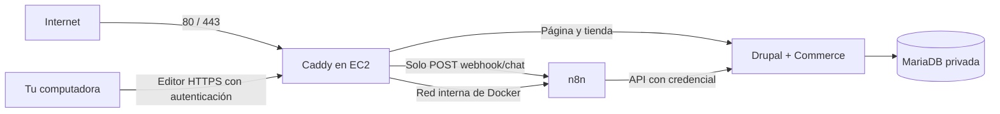

# Desplegar BALTO en una EC2

**Estado: BALTO desplegado en EC2 y demo completa comprobada.** Se utiliza una EC2 nueva `t3.medium`, Ubuntu 24.04 y disco raíz de 30 GiB. La dirección actual es **https://balto-veterinaria.3-211-103-160.sslip.io**, con certificado público de HTTPS verificado. Tiene asociada la Elastic IP **3.211.103.160** a la instancia BALTO `i-0b34b63cdbe1fd079`, confirmada en la consola. El enlace se conserva al detener e iniciar mientras se mantenga esa asignación. La fase 8 sigue aplazada. La instancia `roma-drupal-n8n` del hotel pertenece a otro equipo y no se modifica.

## Diseño y costo mínimo

Una sola **EC2 t3.medium**, Ubuntu Server **24.04 LTS x86_64**, disco raíz **gp3 de 30 GB**, una **Elastic IP** y Docker Compose. Drupal, MariaDB, n8n y Caddy comparten la máquina. No se utilizan RDS, ALB, NAT Gateway, Route 53, S3 ni CloudWatch de pago. Los backups se guardan en el disco y se descargan a la computadora.

Se mantiene t3.medium porque sus 4 GiB permiten ejecutar los servicios y construir Commerce con más margen que una instancia de 2 GiB. La swap de 2 GiB ayuda durante la construcción; no sustituye la RAM. Elige CPU **Standard**, que puede limitar rendimiento al agotar créditos, para evitar cobros por CPU Unlimited. La [documentación de Standard](https://docs.aws.amazon.com/AWSEC2/latest/UserGuide/burstable-performance-instances-standard-mode.html) describe ese comportamiento.



Caddy publica la tienda y sus webhooks autorizados. El editor puede accederse por HTTPS con autenticación de Caddy. MariaDB y Apache se comunican por la red interna. Se usa la red Docker `172.29.240.0/24`, con el proxy en `172.29.240.10`. Drupal confía en cabeceras reenviadas únicamente desde esa dirección. El [comportamiento de cabeceras de Caddy](https://caddyserver.com/docs/caddyfile/directives/reverse_proxy) respalda esta configuración.

## Estimación verificada en AWS Pricing Calculator

Verificación: **12 de noviembre de 2026**, región **US East (N. Virginia), us-east-1**, Linux, compartida, On-Demand, una instancia, 730 horas, sin compromisos de ahorro, monitoreo detallado desactivado y tráfico seleccionado en cero. Se configuraron EC2/EBS y VPC/IPv4 en la calculadora oficial mediante su interfaz.

| Concepto | Cálculo para 730 horas | USD/mes |
| --- | --- | ---: |
| EC2 t3.medium | 730 × 0.0416 | 30.37 |
| EBS gp3, 30 GB | 30 × 0.08 | 2.40 |
| Una IPv4 pública / Elastic IP | 730 × 0.005 | 3.65 |
| **Total de la calculadora** | | **36.42** |

[Estimación guardada en la calculadora oficial](https://calculator.aws/#/estimate?id=47d3105a56bad506b85e1e50cbc84d4a5c2808d2), [datos de la estimación](aws-cost-estimate.json), [texto del resumen](aws-calculadora-resumen.txt) y [captura del total](capturas/aws-calculadora-total.png). El enlace público de la estimación caduca un año después de guardarse y no contiene credenciales ni recursos de una cuenta.


Esto no incluye impuestos, tráfico adicional ni servicios que se añadan después. No se aplica por adelantado ningún descuento de Free Tier o crédito promocional. AWS confirma que las [IPv4 cuestan USD 0.005/h, usadas o inactivas](https://aws.amazon.com/vpc/pricing/), y que [gp3 incluye 3000 IOPS y 125 MB/s](https://aws.amazon.com/ebs/pricing/): conserva esos valores base.

**Plan recomendado:** usar unas 20 horas de EC2 en el mes y detenerla al acabar cada sesión. Si conservas el disco y la IP durante todo el mes, el cálculo con las tarifas verificadas es **USD 6.88**: 20 × 0.0416 + 2.40 + 3.65. Este segundo importe es un cálculo con esas tarifas, no otra estimación guardada de la calculadora. No uses el porcentaje reducido de utilización de la calculadora para asumir que EBS desaparece al detener EC2: el disco sigue cobrando mientras exista.

Los USD 50 de crédito no equivalen a un límite técnico de facturación. Revisa saldo, vencimiento y servicios elegibles en tu cuenta. El saldo promocional no se renueva por cambiar de mes.

## Antes de lanzar: cuenta y presupuesto

Necesitas acceso a la consola de AWS y permiso para EC2, EBS, Security Groups y Elastic IP. En este entorno no hay una sesión AWS configurada.

- **Cuenta personal:** configura el presupuesto descrito a continuación y revisa **Billing → Credits**.
- **AWS Academy / Learner Lab:** inicia el laboratorio y usa su consola temporal; revisa también el saldo y las restricciones del laboratorio. Si Budgets, t3.medium o Elastic IP están denegados, consulta al docente; no intentes ampliar permisos IAM por tu cuenta. No crees una cuenta de pago adicional para resolver esa restricción.

Para una cuenta con permisos de facturación:

1. Abre **Billing and Cost Management → Budgets → Create budget**.
2. Elige un presupuesto de **costo personalizado**, mensual, con importe **USD 40** y nombre `BALTO-demo`.
3. Incluye todos los servicios de la cuenta si está dedicada a la demo; así también detecta recursos accidentales.
4. En los tipos de costo, excluye **Credits** y **Refunds** para observar consumo bruto aunque se descuente de tus créditos.
5. Añade alertas de costo real a **USD 10, 25, 35 y 40**, y una de costo previsto al **100 %**; introduce tu correo y confirma la suscripción si AWS lo solicita.
6. Revisa el presupuesto creado y el saldo disponible antes de cada sesión.

Resultado esperado: presupuesto visible y destinatario de alertas registrado. AWS describe la [creación de presupuestos](https://docs.aws.amazon.com/cost-management/latest/userguide/budgets-create.html) y el [seguimiento del consumo de créditos](https://aws.amazon.com/blogs/startups/how-to-set-aws-budget-when-paying-with-aws-credits/). Las alertas pueden retrasarse y **no detienen automáticamente la instancia**. El presupuesto es mensual; el crédito total puede agotarse entre varios meses. No se configuran acciones automáticas ni nuevos servicios de notificación de pago.

## Crear la clave y el Security Group

**La clave `.pem` permite entrar al servidor: guárdala en tu computadora, fuera de Git. No la pegues en el chat ni en el repositorio.**

1. En la consola selecciona **us-east-1** y abre **EC2 → Network & Security → Key Pairs → Create key pair**.
2. Crea `balto-demo`, tipo ED25519 para Linux/OpenSSH y formato `.pem`; guarda el archivo descargado.
3. Abre **Security Groups → Create security group** y elige la VPC predeterminada.
4. Crea `balto-web` con las reglas de entrada de la tabla.
5. Conserva salida a internet para instalar paquetes y descargar imágenes.

| Tipo | Puerto | Origen |
| --- | ---: | --- |
| SSH | 22 | **My IP**, tu IPv4 pública `/32` |
| HTTP | 80 | `0.0.0.0/0` |
| HTTPS | 443 | `0.0.0.0/0` |

Resultado esperado: grupo con estas tres reglas; sin 3306, 5678, 8080 ni rangos SSH abiertos. Si tu IP cambia, actualiza solo la regla SSH. La [documentación de Key Pairs](https://docs.aws.amazon.com/AWSEC2/latest/UserGuide/ec2-key-pairs.html) explica el uso de la clave privada.

## Lanzar la instancia

**Desde el lanzamiento empiezan los cargos de EC2 y almacenamiento.**

1. Abre **EC2 → Instances → Launch instances** y usa el nombre `BALTO-demo`.
2. Selecciona la AMI oficial de **Ubuntu Server 24.04 LTS, 64-bit x86**, sin Ubuntu Pro ni software Marketplace de pago.
3. Selecciona **t3.medium** y el key pair `balto-demo`.
4. En red elige la VPC predeterminada y una subred pública con ruta al Internet Gateway; selecciona el Security Group `balto-web`. Puedes desactivar la IPv4 automática porque asociarás enseguida la Elastic IP.
5. Configura el disco raíz **gp3, 30 GiB, 3000 IOPS, 125 MiB/s**, cifrado con la clave administrada por AWS; conserva eliminación al terminar la instancia, después de descargar backups.
6. En detalles avanzados deja monitoreo detallado desactivado y CPU credits en **Standard**. Si no aparece en el lanzamiento, cámbialo en los ajustes de crédito de la instancia antes de construir el proyecto. Exige IMDSv2; no se necesita rol IAM para ejecutar esta aplicación.
7. Lanza una sola instancia y espera a que esté ejecutándose.

Resultado esperado: una EC2 y un solo disco raíz. No crees un balanceador, NAT Gateway, base administrada ni una VPC con asistentes que añadan NAT. Si tu cuenta no tiene VPC predeterminada, utiliza una VPC/subred pública existente permitida.

## Asociar una Elastic IP

1. Abre **EC2 → Network & Security → Elastic IP addresses → Allocate Elastic IP address**.
2. Selecciona el pool de Amazon y asigna **una sola** dirección.
3. Abre **Actions → Associate Elastic IP address**.
4. Selecciona la instancia `BALTO-demo` y su IP privada principal.
5. Copia la IPv4 asignada para sustituir `TU_ELASTIC_IP` en los comandos siguientes.

Resultado esperado: IP asociada a la instancia. AWS indica que una [Elastic IP permanece asignada hasta liberarla y se cobra incluso inactiva](https://docs.aws.amazon.com/AWSEC2/latest/UserGuide/elastic-ip-addresses-eip.html). No confundas desasociar con liberar.

## Conectar por SSH

En tu computadora, desde la carpeta que contiene la clave:

```bash
chmod 400 balto-demo.pem
ssh -i balto-demo.pem ubuntu@TU_ELASTIC_IP
```

Comprueba la identidad del servidor al conectar. Resultado esperado: terminal de Ubuntu en EC2. Los marcadores `TU_ELASTIC_IP` no son direcciones reales. Si falla, revisa que la IP esté asociada, la instancia esté ejecutándose y SSH permita tu IP actual.

## Autorizar el repositorio privado de GitHub

El código del proyecto está en un repositorio **privado**: <https://github.com/dimas-flores/balto-veterinaria>. No contiene `.env`, bases ni claves privadas. Para clonar desde EC2 se utiliza una clave de despliegue de solo lectura, limitada a este repositorio.

1. En EC2, como usuario `ubuntu`, ejecuta:

   ```bash
   ssh-keygen -t ed25519 -f ~/.ssh/balto-deploy -C balto-ec2 -N ''
   cat ~/.ssh/balto-deploy.pub
   ```

2. En GitHub abre el repositorio → **Settings → Deploy keys → Add deploy key**, pega **solo la clave pública** y deja desmarcado **Allow write access**.
3. En EC2 configura el archivo `~/.ssh/config`:

   ```text
   Host github.com
     HostName github.com
     User git
     IdentityFile ~/.ssh/balto-deploy
     IdentitiesOnly yes
   ```

4. Protege y comprueba la conexión:

   ```bash
   chmod 600 ~/.ssh/config ~/.ssh/balto-deploy
   ssh -T git@github.com
   ```

5. En la primera conexión compara la huella presentada con las [huellas oficiales de GitHub](https://docs.github.com/en/authentication/connecting-to-github-with-ssh/githubs-ssh-key-fingerprints) antes de aceptar.

Resultado esperado: GitHub reconoce la clave y avisa que no proporciona shell; ese comando puede terminar con código 1 aunque la autenticación sea correcta. El procedimiento usa el mecanismo oficial de [deploy keys](https://docs.github.com/en/authentication/connecting-to-github-with-ssh/managing-deploy-keys). No copies tu contraseña o token personal al script ni al URL del repositorio.

## Aprovisionar y levantar la tienda

Primero copia el script desde tu computadora:

```bash
scp -i balto-demo.pem scripts/aws-setup.sh ubuntu@TU_ELASTIC_IP:/home/ubuntu/aws-setup.sh
```

En EC2 ejecuta:

```bash
sudo bash /home/ubuntu/aws-setup.sh \
  --repo git@github.com:dimas-flores/balto-veterinaria.git \
  --host TU_ELASTIC_IP
```

El script instala Docker y Compose desde el [repositorio oficial para Ubuntu](https://docs.docker.com/engine/install/ubuntu/), clona el proyecto como `ubuntu`, configura swap, genera secretos nuevos, adapta las URL y coloca la configuración AWS como `docker-compose.override.yml`. No acepta un `.env` de desarrollo existente: una instalación AWS se marca como tal y las siguientes ejecuciones conservan sus secretos.

Para seguimiento:

```bash
cd /opt/balto-veterinaria
sudo docker compose ps -a
sudo docker compose logs -f drupal-init n8n
```

Resultado esperado: MariaDB, Drupal, n8n y proxy ejecutándose; `drupal-init` finalizado con código 0. La construcción inicial puede tardar por las descargas y por CPU Standard. Abre **`http://TU_ELASTIC_IP`**. El webhook público será **`http://TU_ELASTIC_IP/webhook/chat`**.

El arranque habitual queda en un solo comando desde el repositorio:

```bash
sudo docker compose up -d
```

El script de aprovisionamiento descarga actualizaciones de la rama por avance rápido al volver a ejecutarlo. Revisa los cambios y realiza backup antes de actualizar una instalación que ya contiene pedidos.

## Entrar a administración y n8n

Las cuentas de prueba conservan los nombres documentados en el README, pero **las contraseñas del servidor son distintas de las locales**. Consúltalas en `/opt/balto-veterinaria/.env` desde tu sesión SSH; no las publiques en capturas.

### Editor de n8n por HTTPS con la IPv4 de la EC2

1. Añade `BALTO_EDITOR_IP=TU_ELASTIC_IP`, `N8N_EDITOR_BASE_URL=https://TU_ELASTIC_IP/` y `N8N_SECURE_COOKIE=true` al `.env` privado. Conserva la URL pública del webhook del chat.
2. Genera un hash con `sudo docker compose exec proxy caddy hash-password`. Copia `deploy/caddy-sites/editor-ip.caddy.example` a `deploy/caddy-sites/editor-ip.caddy` y reemplaza el marcador con el hash. El archivo local queda excluido de Git.
3. Aplica la configuración con `sudo docker compose up -d n8n proxy`. Importa en el equipo de administración el certificado raíz público de Caddy de `/data/caddy/pki/authorities/local/root.crt` en el contenedor `proxy`.
4. Abre `https://TU_ELASTIC_IP/workflow/baltoChatbot` e inicia sesión. El editor usa el 443. Mantén el puerto 5678 cerrado en el grupo de seguridad.

En la EC2 de BALTO, la tienda y el webhook web se sirven por HTTP. Un dominio independiente puede servir el webhook de Telegram por HTTPS. Para reproducir esa ruta, configura `BALTO_TELEGRAM_SITE_ADDRESS` y copia `deploy/caddy-sites/telegram.caddy.example` como `deploy/caddy-sites/telegram.caddy`. Conserva el secreto del webhook fuera de Git.

Sin dominio, HTTP sirve para esta demo con datos ficticios; no utilices datos reales de clientes. Para un uso real configura HTTPS antes de introducirlos.

## HTTPS opcional si ya tienes un dominio

No hace falta comprar un dominio para completar la demo. Si ya dispones de uno:

1. Crea en tu proveedor un registro DNS **A** del nombre elegido a la Elastic IP; elimina un AAAA incorrecto si lo hubiera.
2. Espera a que el nombre resuelva a esa IP y comprueba que 80 y 443 estén abiertos.
3. En EC2 ejecuta:

   ```bash
   sudo bash /home/ubuntu/aws-setup.sh \
     --repo git@github.com:dimas-flores/balto-veterinaria.git \
     --host tienda.TU_DOMINIO --https
   ```

4. Abre `https://tienda.TU_DOMINIO` y comprueba el certificado y una pregunta en el chat.

Resultado esperado: Caddy gestiona el certificado y la redirección a HTTPS, sin otro servicio AWS. Drupal recibe el esquema correcto desde el proxy confiable. En la instancia actual se verificó la emisión de un certificado público con el subdominio gratuito de sslip.io descrito más abajo.

## Guardar y descargar un backup

**La copia detiene Drupal y n8n brevemente. Hazla fuera de la presentación. Contiene credenciales y datos: no la subas a GitHub.**

En EC2:

```bash
cd /opt/balto-veterinaria
sudo bash scripts/backup.sh
```

Resultado esperado: carpeta privada en `backups/balto-FECHA-IDENTIFICADOR` con:

| Archivo | Contenido |
| --- | --- |
| `mariadb.sql.gz` | Base del negocio, incluyendo pedidos y existencias |
| `drupal-files.tar.gz` | Archivos e imágenes subidos a Drupal |
| `n8n-data.tar.gz` | SQLite, workflow y credenciales cifradas de n8n |
| `environment.env` | Secretos de esa instalación, necesarios para recuperar DB y n8n |
| `git-commit.txt` | Versión del código de la copia |
| `SHA256SUMS` | Comprobaciones de integridad |
| `COMPLETE` | Marcador escrito al completar la copia |

El script intenta reiniciar Drupal y n8n incluso si la copia falla. Revisa `sudo docker compose ps` después. No elimina copias anteriores ni configura almacenamiento de pago.

Para descargar, reemplaza `NOMBRE_CARPETA` por el nombre que imprimió el script. En EC2 empaqueta y entrega al usuario SSH:

```bash
sudo tar -czf /home/ubuntu/balto-backup.tar.gz -C /opt/balto-veterinaria/backups NOMBRE_CARPETA
sudo chown ubuntu:ubuntu /home/ubuntu/balto-backup.tar.gz
chmod 600 /home/ubuntu/balto-backup.tar.gz
```

En tu computadora:

```bash
scp -i balto-demo.pem ubuntu@TU_ELASTIC_IP:/home/ubuntu/balto-backup.tar.gz .
```

Conserva al menos una copia fuera de EC2 antes de terminarla. Para cuidar el disco de 30 GB, revisa `df -h` y el tamaño de `backups`; elimina manualmente solo copias antiguas que ya hayas descargado y verificado. Los certificados de Caddy no están en este backup: pueden emitirse de nuevo al recuperar el sitio.

## Recuperar en una instalación vacía

**Procedimiento de restauración: sobrescribe las tablas y extrae archivos del backup. Úsalo en una instalación nueva, nunca sobre la única copia del negocio.** La restauración SQL se probó localmente; la recuperación completa en una EC2 nueva queda pendiente.

Prepara Ubuntu, acceso GitHub y el backup como en las secciones anteriores. `RUTA_BACKUP` representa la carpeta extraída, con `COMPLETE` y `SHA256SUMS` válidos.

1. Ejecuta el aprovisionamiento con `--prepare-only`: instala dependencias y prepara archivos, pero no inicia los volúmenes.
2. Verifica `sha256sum --check SHA256SUMS` desde el directorio del backup y coloca `environment.env` como `/opt/balto-veterinaria/.env`, propietario `ubuntu`, permisos `0600`. Usa el código del commit de `git-commit.txt`.
3. Adapta únicamente el host con `python3 scripts/configure-aws-env.py --host TU_ELASTIC_IP` (añade `--https` si corresponde). No generes otras claves; las del backup permiten descifrar n8n.
4. Desde el proyecto ejecuta `sudo docker compose build` y `sudo docker compose up -d --wait mariadb`.
5. Importa SQL:

   ```bash
   gzip -dc RUTA_BACKUP/mariadb.sql.gz | sudo docker compose exec -T mariadb sh -c 'export MYSQL_PWD="$MARIADB_PASSWORD"; exec mariadb --user="$MARIADB_USER" "$MARIADB_DATABASE"'
   ```

6. Restaura los volúmenes sin iniciar las aplicaciones:

   ```bash
   sudo docker compose run --rm --no-deps -T --entrypoint tar drupal -xzf - -C /opt/drupal/web/sites/default/files < RUTA_BACKUP/drupal-files.tar.gz
   sudo docker compose run --rm --no-deps -T --entrypoint tar n8n -xzf - -C /home/node/.n8n < RUTA_BACKUP/n8n-data.tar.gz
   ```

7. Ejecuta `sudo docker compose up -d`, comprueba los pedidos y repite la demo siguiente.

## Validar en la instancia: demo de cinco minutos

Esta comprobación se ejecutó en **AWS EC2**, en http://54.236.251.160: **17 comprobaciones correctas** en 52 segundos. Pedido **1**, stock de la pelota de **25 a 24**, edición de precio desde el panel y restauración comprobadas. [Informe de la demo EC2](verificacion-fase-9-ec2.json).

1. **Minuto 0–1:** abre la URL pública y pregunta por un producto con stock; comprueba que diga que el inventario es de ejemplo.
2. **Minuto 1–2:** abre el enlace del producto y agrégalo al carrito.
3. **Minuto 2–3:** registra un pedido con datos ficticios y pago simulado.
4. **Minuto 3–4:** inicia sesión como encargado de tienda y abre el pedido en `/admin/commerce/orders`.
5. **Minuto 4–5:** vuelve al chat y consulta el mismo producto; comprueba la unidad descontada. Abre también el sitio desde un celular.

Resultado esperado: pedido visible, un solo pago ficticio y existencias actualizadas en el chat. Registra URL, fecha y número del pedido de esta ejecución cuando se haga en EC2. No uses un número de pedido local como evidencia AWS.

## Detener, reanudar y evitar cargos olvidados

Para pausar la demo:

1. Si necesitas conservar una copia fuera del servidor, realiza y descarga el backup.
2. En EC2 selecciona `BALTO-demo` → **Instance state → Stop instance**.
3. Espera estado **Stopped** y revisa que no exista otra instancia encendida.

Resultado esperado: se detiene el cómputo. **EBS y Elastic IP siguen cobrando** mientras existan. AWS explica el [ciclo Stop/Start](https://docs.aws.amazon.com/AWSEC2/latest/UserGuide/Stop_Start.html); conserva la Elastic IP si necesitas la misma URL al reanudar.

Para reanudar, elige **Start instance**, espera los chequeos y entra por SSH:

```bash
cd /opt/balto-veterinaria
sudo docker compose up -d
```

Docker y los servicios con política de reinicio se recuperan al arrancar, pero ejecuta ese comando para volver a aplicar las dependencias de inicialización. No cambies `.env` entre pausas.

**Cuando termine definitivamente la entrega:** descarga y verifica el backup, termina la instancia, comprueba que el EBS raíz se haya eliminado y **libera** la Elastic IP. Revisa discos, snapshots e IP sin usar en la región. Terminar y eliminar el disco destruye esa instalación; no lo uses como pausa diaria. No se ejecuta ninguna de estas acciones destructivas automáticamente.

## Checklist de seguridad y estado

- [ ] Cuenta o laboratorio confirmado y crédito vigente revisado.
- [ ] Presupuesto y alertas configurados, si el tipo de cuenta lo permite.
- [x] Una EC2 BALTO y un disco gp3 de 30 GiB; sin servicios administrados adicionales.
- [x] Elastic IP 3.211.103.160 asignada y asociada a BALTO.
- [x] SSH solo desde tu IP; 80/443 públicos, según la configuración revisada en consola.
- [ ] CPU Standard y monitoreo detallado desactivado.
- [x] Clave privada fuera de Git; deploy key de GitHub de solo lectura.
- [x] `.env` de servidor generado con secretos nuevos y permisos `0600`.
- [x] n8n limitado a loopback; MariaDB y Apache sin publicación de puertos.
- [x] HTTPS comprobado con el subdominio gratuito de sslip.io.
- [x] Backup descargado y checksums verificados.
- [x] Demo completa ejecutada en la URL pública real.
- [ ] Instancia detenida al finalizar cada sesión.

## Lo que se verificó sin gastar crédito AWS

Se ejecutaron [10 comprobaciones de configuración](verificacion-fase-9-config.json) y [9 comprobaciones locales de despliegue/backup](verificacion-fase-9-local.json), con secretos nuevos y volúmenes aislados. Caddy sirvió Drupal y el webhook bajo el mismo origen. El backup incluyó SQL, archivos, SQLite y entorno privado; se verificaron checksums y se restauró el SQL en una base temporal con 15 productos y 15 variaciones. La demo local principal no fue modificada por estas pruebas.

`aws-setup.sh` se ejecutó correctamente en Ubuntu 24.04 de la instancia BALTO. Se repitió la compra completa desde su IP pública con resultados en el informe EC2 anterior. La Elastic IP ya está asociada. Siguen pendientes confirmar CPU Standard y configurar alertas si el laboratorio lo permite. Ya se emitió y verificó un certificado público para el nombre gratuito de sslip.io. El importe de la calculadora es una estimación, no una factura ni una reserva de crédito.


También se realizó un [backup en EC2 y se comprobó la recuperación del servicio](verificacion-fase-9-backup.json). Los checksums fueron correctos y estaban presentes SQL, archivos Drupal y SQLite n8n. Se verificó que los secretos del servidor eran distintos de los locales y que `.env` tenía permisos `0600`. La copia permanece privada en `/opt/balto-veterinaria/backups/`; se descargó también una copia privada fuera de EC2, en `.local/share/balto-dev/aws-backups/` de esta computadora.

## Nombre gratuito y HTTPS activos

URL actual: **https://balto-veterinaria.3-211-103-160.sslip.io**. Se usa el servicio de DNS automático [sslip.io / nip.io](https://sslip.io/): la IP está incluida en el nombre y el proveedor la resuelve sin registrar una cuenta. No se creó una cuenta DuckDNS ni se compró un dominio. Este método no demuestra cómo se configuró el proyecto del hotel; su enlace no se ha proporcionado.

Se adaptó el entorno existente sin cambiar secretos, pedidos ni inventario:

```bash
python3 scripts/configure-aws-env.py --host balto-veterinaria.3-211-103-160.sslip.io --https
sudo docker compose up -d
```

Caddy obtuvo el certificado público y redirige HTTP a HTTPS. Se comprobaron la cadena de confianza TLS, portada, acceso Drupal, enlaces de producto y el chat en el mismo origen. El precio de la pelota sigue en S/ 12.90 y su saldo en 24 tras la demo de EC2. [Informe de HTTPS](verificacion-dominio-https.json). La IP numérica anterior deja de ser la dirección de acceso configurada; utiliza el enlace HTTPS de esta sección.

El nombre apunta a la Elastic IP 3.211.103.160. No liberes esa IP si necesitas conservar el enlace. Una detención normal mantiene la asignación; un reinicio completo o eliminación de recursos del laboratorio puede requerir volver a configurar el despliegue.


### Mercado Pago Checkout Pro de prueba

Configura `BALTO_MERCADO_PAGO_TEST_TOKEN` con el token del vendedor de prueba y
`BALTO_MERCADO_PAGO_TEST_BUYER_ID` con el ID del comprador de prueba. Mantén estos
valores en el `.env` privado de EC2. Drupal habilita **Tarjeta (simulado)** cuando
dispone de ambas cuentas. Completa la compra con la tarjeta de prueba y vuelve
a BALTO para que Drupal verifique la operación.

Si se cerró el navegador antes de regresar, busca el ID interno del pedido y
recupera el pago de prueba aprobado con:

```bash
sudo docker compose exec -T drupal vendor/bin/drush php:script /opt/balto/scripts/reconcile-mercado-pago-test.php ID_INTERNO
```

El comando comprueba la referencia, el importe, la moneda y ambas cuentas
antes de registrar el pago. Se puede volver a ejecutar para verificar el mismo
pedido. Esta recuperación es manual y está limitada al ambiente de pruebas.

Para publicar el webhook de Telegram en EC2, configura
`BALTO_TELEGRAM_WEBHOOK_SECRET` con 64 caracteres hexadecimales aleatorios y
registra ese mismo secreto en Telegram para los tipos de evento `message` y
`callback_query`. Caddy verifica ese secreto antes de reenviar la petición a n8n.
