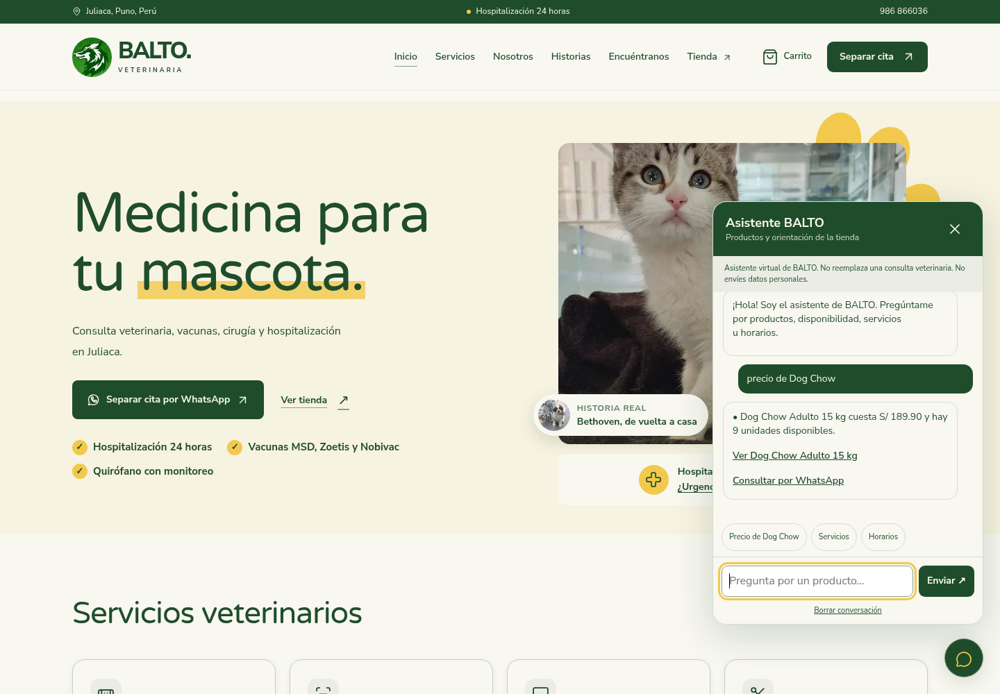
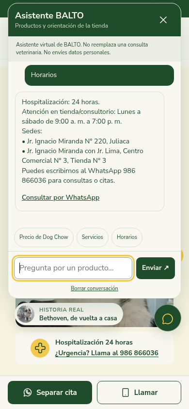
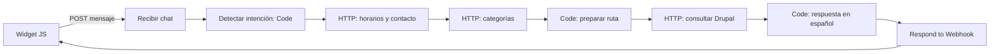

# Usar el asistente de BALTO

El chat consulta los datos actuales de Drupal a través de n8n. Reconoce palabras clave y prepara respuestas en español, sin cuentas de IA ni cargos por modelos externos. Atiende preguntas sobre la tienda y datos del negocio; las citas se coordinan por WhatsApp.

## Conversar desde la tienda

Requisito: servicios Docker iniciados. Abre <http://localhost:8080>.

1. Pulsa **Conversemos** en la esquina inferior derecha.
2. Escribe una consulta o pulsa una sugerencia.
3. Pulsa **Enviar**.
4. Espera la respuesta mientras aparece **Escribiendo…**.
5. Pulsa el enlace de un producto para abrir su detalle y añadirlo al carrito con el formulario habitual.

Resultado esperado: respuesta con datos actuales del catálogo o negocio. Puedes seguir navegando dentro de la misma pestaña y conservar la conversación. **Borrar conversación** elimina el historial de esa pestaña. **Cerrar chat** o la tecla Escape ocultan la ventana y devuelven el foco al botón.

| Pregunta de prueba | Respuesta esperada |
| --- | --- |
| `hola` | Saludo y opciones de ayuda |
| `¿Cuánto cuesta el Dog Chow Adulto 15 kg?` | Precio y saldo actuales, enlace al producto y aviso de inventario de ejemplo |
| `disponibilidad de BAL-ALI-004` | Producto agotado |
| `precio de producto INEXISTENTEZZZ` | Sin coincidencias, sugerencias y WhatsApp |
| `categorías` | Las cinco categorías de Drupal |
| `juguetes` | Productos de la categoría identificada mediante taxonomía |
| `servicios` | Los siete servicios publicados |
| `horarios` | Hospitalización 24 horas; consultorio marcado como ejemplo pendiente de confirmar |
| `direcciones` | Las dos sedes y contacto |
| `quiero separar una cita` | Contacto y enlace a WhatsApp |
| `asdfgh zxcv` | Consulta no entendida, ejemplos y contacto |

Las respuestas muestran hasta cinco productos. Busca un nombre o SKU más específico para reducir coincidencias. El asistente no mantiene contexto entre preguntas: cada mensaje debe contener la consulta completa. El historial visible facilita releer la conversación, pero no se usa para deducir referencias como «ese producto».





## Arrancar el workflow automáticamente

Desde el repositorio ya preparado:

```bash
docker compose up -d --build
```

Resultado esperado: el proceso de arranque de n8n importa la credencial de cabecera, importa y publica el workflow `baltoChatbot` y después inicia el servidor. No necesitas abrir el editor ni pulsar «escuchar evento de prueba» para conversar desde Drupal. En la primera instalación, n8n también migra su base SQLite y puede tardar más.

El archivo [chatbot.json](../n8n/workflows/chatbot.json) es el export importable. Los scripts de arranque usan comandos comprobados en la versión instalada: `import:credentials`, `import:workflow` y `publish:workflow`. La publicación habilita el webhook de producción, como explica la [documentación oficial de n8n](https://docs.n8n.io/hosting/cli-commands/).

El hash persistente evita volver a importar un workflow sin cambios. Si cambias el export, el origen permitido o la URL pública de Drupal, se adapta y publica al recrear n8n. **Una nueva importación del export reemplaza la versión de ese workflow**: guarda antes las personalizaciones realizadas en el editor. Los otros workflows no se importan ni modifican. La credencial administrada se sincroniza con `.env` en cada arranque.

Para revisar n8n, abre <http://localhost:5678>. Crea la cuenta propietaria en la pantalla inicial si todavía no existe; la cuenta se conserva en el volumen. El workflow automático no requiere completar esta pantalla para responder al chat.

## Importar a mano en otra instancia

Estos pasos son para quien administra n8n, si no utiliza el arranque automático del repositorio:

1. Crea una credencial **Header Auth** con nombre `BALTO API interna`.
2. Configura `Name: X-API-KEY` y como valor la clave `VET_API_KEY` del `.env` de Drupal.
3. Importa `n8n/workflows/chatbot.json` mediante **Import from File** del editor.
4. Selecciona esa credencial en los tres nodos **HTTP Request**.
5. Ajusta las direcciones internas de Drupal, el origen permitido de **Recibir chat** y la constante `allowedOrigin` de **Detectar intención**.
6. Ajusta `publicBase` de **Responder en español** a la URL pública de Drupal.
7. Guarda y publica el workflow.

Resultado esperado: `POST /webhook/chat` responde sin mantener una ejecución manual abierta. La [documentación del Webhook](https://docs.n8n.io/integrations/builtin/core-nodes/n8n-nodes-base.webhook/) distingue el webhook de prueba del de producción. El servidor n8n debe poder resolver y alcanzar la dirección usada para Drupal; `http://drupal` funciona dentro de esta red Compose.

## Configurar las URL

| Variable de `.env` | Desarrollo local | Uso |
| --- | --- | --- |
| `DRUPAL_BASE_URL` | `http://localhost:8080` | Enlaces públicos al producto |
| `CHAT_WEBHOOK_URL` | `http://localhost:5678/webhook/chat` | URL que consulta el navegador |
| `CHAT_ALLOWED_ORIGIN` | `http://localhost:8080` | Origen exacto permitido para el widget |
| `WEBHOOK_URL` | `http://localhost:5678/` | URL pública base de webhooks de n8n |
| `VET_API_KEY` | Secreto generado localmente | Autenticación entre n8n y Drupal |
| `N8N_ENCRYPTION_KEY` | Secreto generado localmente | Cifrado de las credenciales persistentes |

Compose transmite `WEBHOOK_URL` también como `N8N_WEBHOOK_URL`, usada por la versión instalada. Después de cambiar URL o claves, recrea los servicios con `docker compose up -d`. Un origen incluye protocolo, host y puerto; `localhost` y `127.0.0.1` son orígenes distintos. No mezcles ambos al abrir la demo. El despliegue HTTPS y proxy de AWS se cubrirá en la fase 9.

## Recorrido de una consulta



Las categorías se consultan para resolver sus identificadores sin fijar IDs de taxonomía. El contacto se obtiene de Drupal para poder ofrecer WhatsApp en respuestas sin coincidencias. Los nodos de código solo procesan texto y datos públicos; los nodos HTTP incluyen la credencial protegida. Los tiempos de espera controlados permiten devolver un mensaje comprensible cuando Drupal no responde.

El código fuente de reglas está en `n8n/code/`; ejecuta `python3 scripts/generate-chat-workflow.py` después de editarlo para regenerar el export. La detección no es un buscador semántico: admite expresiones habituales y nombres o SKU, pero puede requerir reformular consultas ambiguas.

## Comprobaciones y privacidad

- **58 comprobaciones correctas** en las [pruebas del webhook y datos actuales](verificacion-fase-6-chat.json): autenticación interna, intenciones, errores de entrada, origen, preflight, precio y stock consultados desde Drupal.
- **23 comprobaciones correctas** en las [pruebas del widget](verificacion-fase-6-widget.json): escritorio, celular, historial por sesión, navegación al catálogo y carrito, accesibilidad de controles, errores de red y texto remoto seguro.
- El navegador recibe únicamente la URL del webhook; no recibe la API key.
- La clave se importa como credencial cifrada de n8n. El archivo temporal de importación tiene permisos privados y se elimina antes de iniciar el servidor.
- Los nodos tienen bloqueado el acceso al entorno. No se guarda el contenido de ejecuciones exitosas, fallidas o manuales del workflow.
- La conversación permanece en `sessionStorage` de la pestaña y se limita a 40 mensajes. Cada petición envía solo el mensaje actual, sin el historial.
- El widget inserta respuestas con `textContent` y descarta enlaces que no sean productos del mismo sitio o WhatsApp válido.
- CORS permite el origen configurado, y el workflow rechaza orígenes ajenos con 403. El webhook es público: CORS no autentica clientes externos que envíen peticiones fuera de un navegador.

No se añadió un botón de compra directo dentro de la respuesta: el enlace conduce al detalle y usa el formulario de Commerce, con sus validaciones existentes de sesión y stock.

## Repetir las pruebas

**Aviso previo:** la prueba del webhook cambia temporalmente el precio de Dog Chow y lo restaura al finalizar; evita editar ese producto durante la ejecución.

```bash
python3 tests/phase6-chat.py
deno run --node-modules-dir=none --allow-all tests/phase6-browser.mjs
```

La prueba del widget requiere Deno, Puppeteer Core 25.10.0 y Brave/Chromium. Configura `BALTO_BROWSER=/ruta/al/navegador` si usas otro ejecutable. La prueba agrega un producto al carrito de una sesión temporal; no registra un pedido ni descuenta existencias.

## Resolver problemas

| Síntoma | Causa probable | Acción |
| --- | --- | --- |
| No conecta con el asistente | n8n iniciando o URL incorrecta | Revisa `docker compose logs n8n` y `CHAT_WEBHOOK_URL` |
| El navegador rechaza CORS | El origen no coincide | Abre la URL configurada y revisa `CHAT_ALLOWED_ORIGIN` |
| Webhook no registrado | Workflow sin publicar | Revisa los logs de importación y la publicación en el editor |
| El chat no consulta datos | Drupal no responde o credencial incorrecta | Comprueba salud de Drupal y que ambas aplicaciones reciban la misma `VET_API_KEY` |
| No entiende una frase | Las reglas no reconocen esa expresión | Usa nombre/SKU o una consulta sugerida |
| No conserva el historial | Almacenamiento del navegador bloqueado | El chat puede usarse igualmente; no conservará los mensajes |

Fuentes: export y scripts de este repositorio, datos vivos de Drupal, documentación oficial indicada y pruebas reales con navegadores. Siguen pendientes las pruebas globales de fase 7, el guion final de fase 8 y AWS en fase 9.

También se probó el arranque de n8n con un volumen vacío: importó credencial y workflow, publicó el webhook sin completar la cuenta propietaria y devolvió 503 controlado al no tener Drupal en su red de prueba. Después se eliminaron únicamente el contenedor, red y volumen temporales.

La verificación `bash scripts/verify.sh` de las fases 1–6 terminó correctamente. Después se reinició n8n sin cambios del export y el webhook siguió respondiendo; no fue necesaria una nueva importación manual. También se verificó que los archivos temporales con la credencial y el workflow adaptado habían sido eliminados. El export se regenera de forma reproducible desde los tres archivos de reglas.
